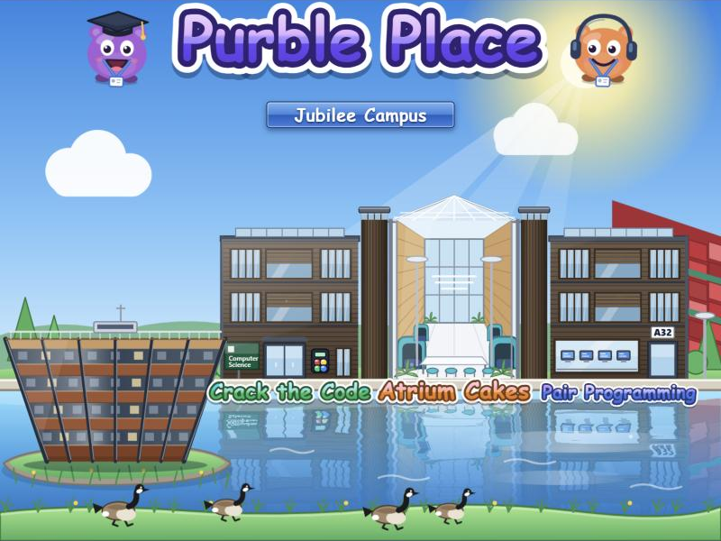
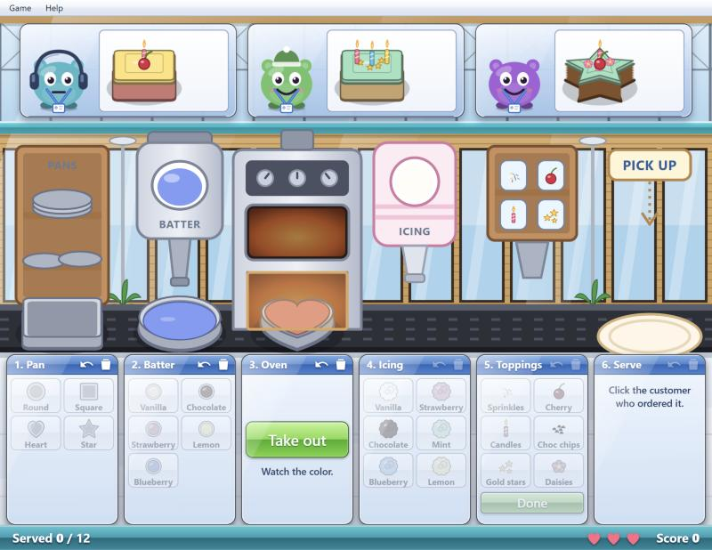
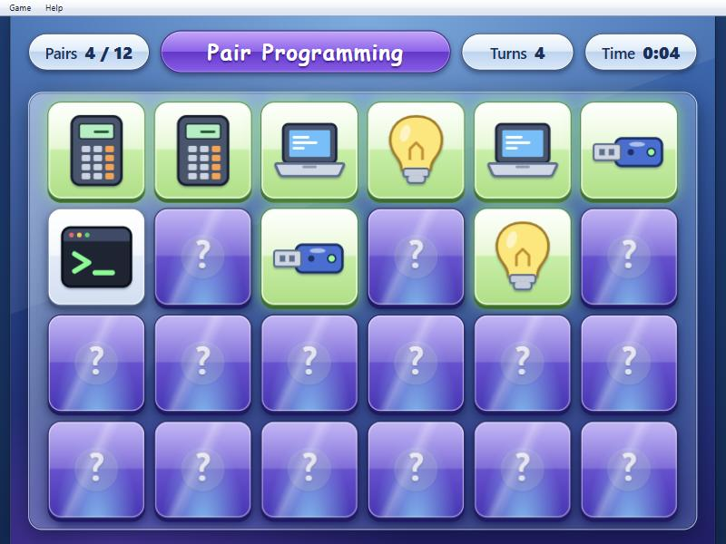
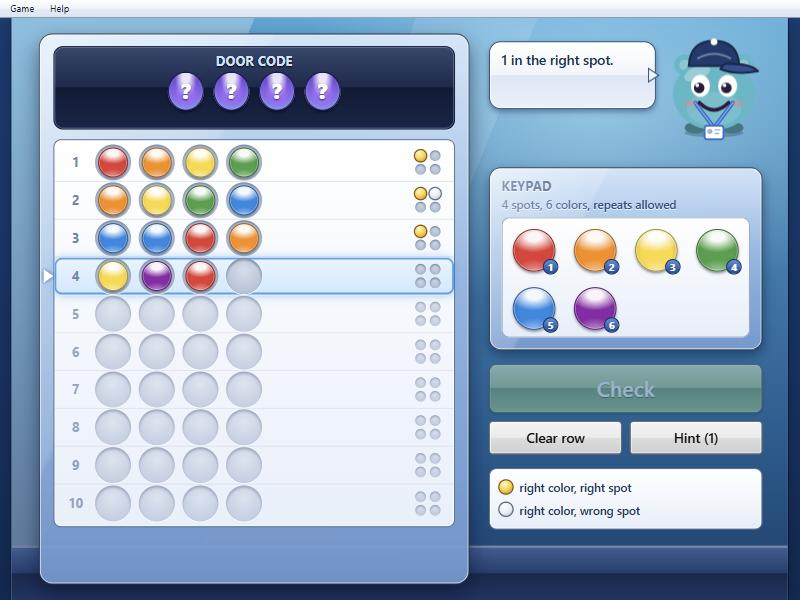

# Purble Place: Jubilee Campus edition

Purble Place for the HackNotts 26 Windows 7 desktop: the three Purble Place games (cakes, matching pairs, code
breaking), set inside the Computer Science building on the University of Nottingham's Jubilee Campus.

The town square is one picture of that building, standing at the lake. The three games are parts of it: the front door
(code breaking), the CS Atrium (cakes) and the A32 Lab (pairs). The scenery is drawn from photos of the real place:
timber cladding and round timber towers, the glass atrium with its teal pods and lamp posts, and the Djanogly Library
on its own island at the front left. A red patchwork building rises behind the right wing and Canada geese walk along
the bank in the foreground. The A32 plate on the lab door is my guess at how to mark the room. It is stylised cartoon
art, not a trace, so it is worth a quick look from someone who knows the place.

This folder is the whole game and nothing else. There is no desktop, taskbar or window chrome in here, so it
drops straight into the OS your teammates are building.

| | |
| --- | --- |
|  |  |
|  |  |

## The games

| Where | Game | What you do |
| --- | --- | --- |
| The CS Atrium | Atrium Cakes | Students order a cake. Build it along the conveyor belt (pan, batter, oven, icing, toppings) and click the student who ordered it. Three mistakes and the Atrium closes. Every station has a step back button (also Ctrl+Z) in case you pick the wrong icing. Baking can't be undone. |
| The A32 Lab | Pair Programming | Memory game. Turn over two tiles at a time and find the pairs. Tiles are laptops, bugs, rubber ducks and so on. In Final Year a merge conflict swaps two face-down tiles every fourth miss. |
| The front door | Crack the Code | Work out the hidden row of colors for the door keypad. Gold peg means right color in the right spot, white peg means right color in the wrong spot. Drag or click to fill the row. |

Each game has three levels: First Year, Second Year and Final Year. Stars and personal bests are saved in the
browser (Game menu, Statistics).

## Running it

ES modules do not load from `file://`, so serve the folder over http. Any of these works.

- Your normal dev server (for example VS Code Live Server) from the repo root, then open `/apps/purble-place/`.
- `python apps/purble-place/tools/serve.py` and open http://localhost:8765/. It sends no-cache headers, so edits show up on a normal reload.

`index.html` in this folder is just the game filling the browser tab. It takes a few URL parameters, handy for testing:
`?game=comfy-cakes&level=advanced&seed=42&mute=1&menubar=0`. Game ids are `comfy-cakes`, `purble-pairs` and `purble-shop`;
level ids are `beginner`, `intermediate` and `advanced` (shown in-game as First, Second and Final Year).

## Opening it from the desktop

The game does not touch the existing desktop files. To launch it from the start menu or a taskbar icon, create a window with
a body element that has a size, then mount into it. The repo's `index.js` is a plain script, so use a dynamic `import()`:

```js
let purble = null;

async function openPurblePlace() {
  if (purble) return;                                         // already open
  const { mount } = await import('./apps/purble-place/src/index.js');
  const body = makeWindow('Purble Place', 800, 623);          // your window code: returns the element to fill
  purble = mount(body, { onExit: closePurblePlace });         // onExit powers Game > Exit
}

function closePurblePlace() {
  purble?.destroy();                                          // removes its DOM, timers, sound and styles
  purble = null;
  // ...then remove the window element
}
```

Window behaviour to wire up:

| When the window is | Call |
| --- | --- |
| minimised or hidden | `purble.pause()` |
| restored | `purble.resume()` |
| clicked or focused | `purble.focus()` (keyboard shortcuts only reach the focused window) |
| resized | nothing, it re-fits itself |
| closed | `purble.destroy()` |

The game draws on a fixed 800 by 600 stage and scales to fit whatever size its container is, letterboxed, so any window
size works. 800 by 623 (stage plus the 23px menu bar) is a good default and `manifest.minSize` is 480 by 383.
`import { manifest } from './apps/purble-place/src/index.js'` also gives you `manifest.icon`, a small SVG string for a
desktop or start menu icon, and `manifest.name`.

It loads its own stylesheet (all classes start with `pp-`, `cc-`, `pr-` or `sh-`) and never touches the page outside its
container, so it will not clash with `styles.css`.

## Options and API

```js
const app = mount(element, {
  menubar: true,            // false to hide the built-in Game/Help bar and draw your own (see getMenuModel)
  startGame: 'comfy-cakes', // optional: skip the town square
  startLevel: 'beginner',   // optional
  sound: true,              // false starts muted
  seed: 42,                 // optional: same seed gives the same boards and orders
  storageKey: 'purble-place', // prefix for saved settings and stats
  storage: localStorage,    // any { getItem, setItem, removeItem }
  onExit: () => {},         // called by Game > Exit
});
```

| Method | Does |
| --- | --- |
| `app.openGame(id, levelId?)` | open a game, asking for a level if none is given |
| `app.goHome()` | back to the town square |
| `app.newGame()` | restart the current game (F2) |
| `app.pause()` and `app.resume()` | freeze and unfreeze the game clock |
| `app.focus()` | give the game keyboard focus |
| `app.setMuted(true)` | mute or unmute |
| `app.getMenuModel()` | the Game and Help menus as plain data, for a custom menu bar |
| `app.destroy()` | clean up everything |

Events, with `app.on(name, fn)` (it returns an unsubscribe function, and `'*'` hears everything):

| Event | Data |
| --- | --- |
| `navigate` | `{ view: 'hub' }` or `{ view: 'game', game }` |
| `game:start` | `{ game, level }` |
| `game:end` | `{ game, level, won, stars, score, time, moves }` |
| `settings` | `{ muted, colorblind }` |

`game:end` is the one to use for anything like achievements or notifications in the OS.

Saved data lives in `localStorage` under keys starting with `purble-place:`. Pass `storage` if the OS has its own
virtual file system.

There is also a `<purble-place>` HTML element (`src/element.js`) if you would rather not write any JavaScript:
`<purble-place game="purble-pairs" level="beginner" style="width:800px;height:623px"></purble-place>`.

## Changing things

| To change | Edit |
| --- | --- |
| Any wording, game names, level names | `src/i18n/en.js` (game and level names are also set in each game's `index.js`) |
| The town square picture, and where each game's clickable area sits in it | `src/shell/campus.js` (the `CAMPUS_SPOTS` rectangles match the drawing, so move them together) |
| The Atrium Cakes room | `sceneMarkup()` in `src/games/comfy-cakes/art.js` |
| Cake menu, customers, patience, oven timing | `src/games/comfy-cakes/config.js` and `logic.js` |
| Pair Programming board sizes and tile icons | `PAIRS_LEVELS` in `src/games/purble-pairs/logic.js`, `SYMBOLS` in `art.js` |
| Code length, colors, guesses | `SHOP_LEVELS` in `src/games/purble-shop/logic.js` |
| Colors, fonts, the Aero look | `src/styles/base.css` (variables at the top) and the other css files |

Each game is split into `logic.js` (the rules, no DOM), `art.js` (SVG drawn in code) and `index.js` (the view). All the
pictures and sounds are generated in code, so there are no image or audio files to manage.

The cartoon font on the town square is whatever the visitor has (Comic Sans MS on Windows). To pin a different one, set
`--pp-display-font` on `.pp-root`.

## Adding another game

A game is a class extending `MiniGame` plus a definition object, registered with `mount(el, { games: [def] })` or
`registerGame(def)`. `test/fixtures/hello-purble.js` is a complete 90 line example (it is only used by the tests).
You get level picking, pausing, a game clock, results, stats, sound and menus for free. The scene only has spots for the three
built-in games, so if you add a fourth the town square switches to a row of small buildings (one per game) over the same
backdrop. To give a new game a spot in the picture, add a rectangle for its id in `CAMPUS_SPOTS`.

## Tests

Start a server and open `/apps/purble-place/test/index.html`. The tab title says `PASS` and the count when everything
is fine (166 tests: rules for all three games, a bot that plays every Comfy Cakes level, the undo feature, menus,
drag and drop, the custom element).

## Folder layout

```
apps/purble-place/
  index.html            the game in a full browser tab
  src/
    index.js            mount(), registerGame(), manifest
    element.js          <purble-place> element
    shell/              app shell, town square, campus scene (campus.js), menu bar
    core/               game base class, dialogs, audio, storage, characters
    games/
      comfy-cakes/      config.js  logic.js  art.js  index.js
      purble-pairs/     logic.js  art.js  index.js
      purble-shop/      logic.js  art.js  index.js
    i18n/en.js          all the text
    styles/             css
  test/                 browser test suite (open test/index.html)
  tools/                serve.py (dev server), art-gallery.html (every picture on one page)
  docs/                 screenshots for this README
```

## About the name

Purble Place and its characters are Microsoft's. Nothing from Microsoft is in this folder: no files were taken from
the original game, and all the art and sound is generated by the code here.
